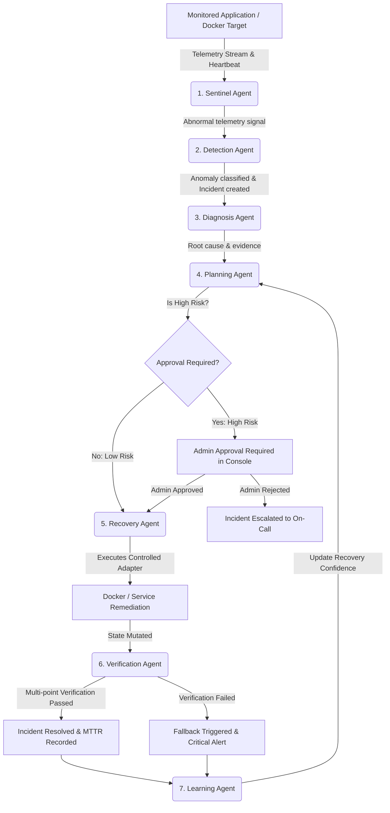

# SHARP Architecture & Resilience Engineering Design

## 1. Resilience Philosophy & Core Principles

SHARP operates on three foundational cybersecurity and resilience tenets:

1. **Defense-in-Depth & Risk Tiering**:
   - Recovery actions are divided into **LOW RISK** (e.g. graceful container restart with SIGTERM, cache invalidation) and **HIGH RISK** (e.g. horizontal scaling, image rollback, container pruning).
   - High-risk actions strictly mandate dual-custody administrator approval via the web console.
   - Autonomous execution is only permitted for pre-approved, allowlisted low-risk operations.

2. **No Arbitrary Execution (Zero Shell Injection)**:
   - AI models and agents are strictly forbidden from generating or executing raw shell strings.
   - All actions pass through strongly typed parameters and allowlisted Docker/OS adapters with parameter validation.

3. **Independent Verification**:
   - The platform never trusts an agent's claim that an operation succeeded.
   - The Verification Agent acts independently from the Recovery Agent, conducting direct HTTP health checks, checking container process state, and polling CPU/memory stability before marking an incident as resolved.

---

## 2. Seven Specialized Agents Resilience Loop

